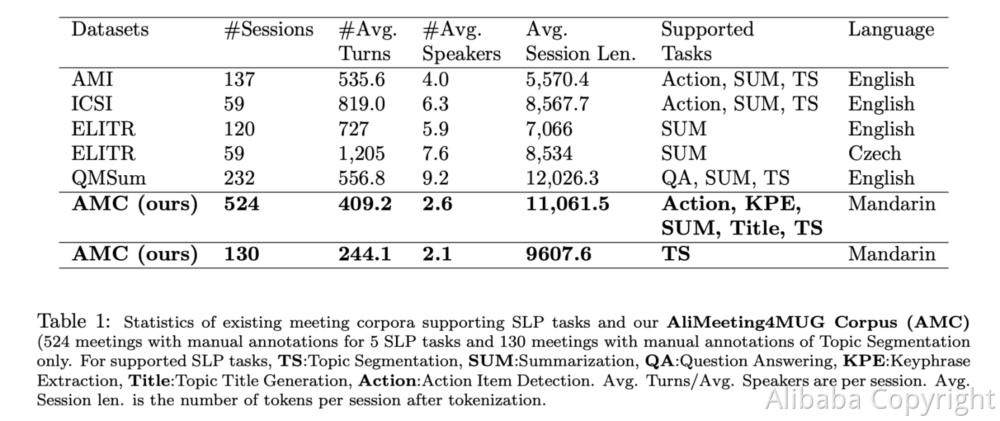
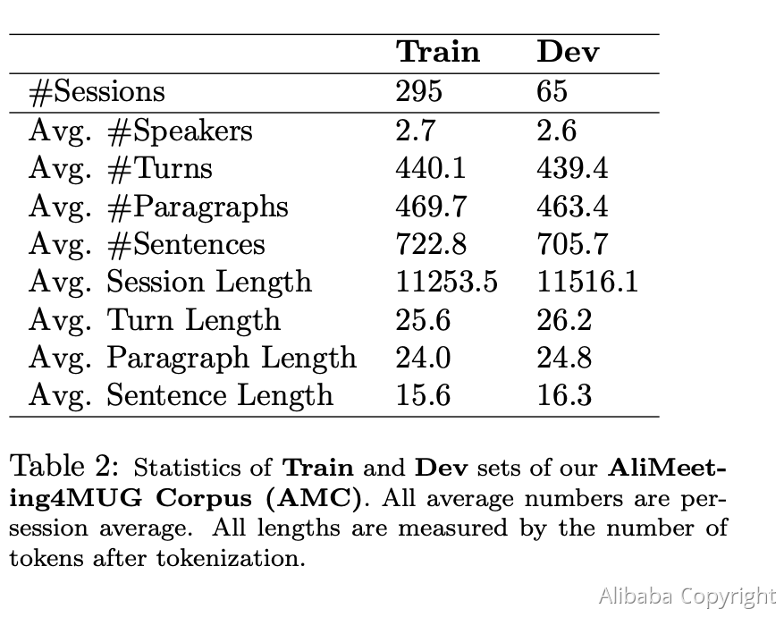
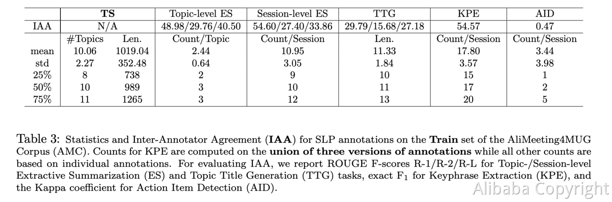

# Introduction
To fuel the Spoken Language Processing (SLP) research on meetings and tackle the key challenges, the Speech Lab and the Language Technology Lab and the ModelScope Community of Alibaba Group, Alibaba Cloud Tianchi Platform, and Zhejiang University launch a General Meeting Understanding and Generation (MUG) challenge, as an ICASSP2023 Signal Processing Grand Challenge. The MUG challenge includes five tracks: Track 1 Topic Segmentation (TS), Track 2 Topic-level and Session-level Extractive Summarization (ES), Track 3 Topic Title Generation (TTG),  Track 4 Keyphrase Extraction (KPE), and Track 5 Action Item Detection (AID).  We conduct data privacy review on the AliMeeting4MUG Corpus and make sure that the AliMeeting4MUG Corpus has no personally identifiable information nor private information.

To facilitate the MUG benchmark, we construct and release a meeting dataset,  the AliMeeting4MUG Corpus (AMC), which consists of 654 recorded Mandarin meeting sessions with diverse topic coverage, with manual annotations for SLP tasks on manual transcripts of meeting recordings.  As compared to the existing meeting corpora supporting SLP tasks in Table1, to the best of our knowledge, AMC is so far the largest meeting corpus in scale and facilitates the most SLP tasks.  We build baseline systems and report evaluation results on the MUG tasks. Next, we introduce AMC, provide data analysis, and describe data loader.



# Data Collection and Annotations
The AliMeeting4MUG Corpus (AMC) comprises 654 meetings, including 524 meetings with all five SLP annotations (TS, ES, TTG, KPE, and AID) and 130 meetings with TS annotation only. Each meeting session consists of a 15- to 30-min discussion by 2-4 participants covering certain topics. We create manual transcripts for audio together with manually inserted punctuation and manual speaker labels, with careful quality control [5]. Next, we segment documents into paragraphs using our text segmentation model [6]. Then, we conduct manual annotations for the five SLP tasks (TS, ES, TTG, KPE, and AID).

For Track 2 to Track 5, we randomly partition the 524 meeting sessions with manual annotations for all five SLP tasks into 295 sessions for training (Train), 65 sessions for system development (Dev), 82 sessions (exceptTS-Test1) as First Stage Evaluation Data for regular update of ranking during the challenge and 82 sessions (exceptTS-Test2) as Final Evaluation Data for final leaderboard ranking.
For Track 1 Topic Segmentation, we randomly partition the 130 meeting sessions with TS annotation only into 65 sessions (TS-Test1) as First Stage Evaluation Data for Track TS regular update of ranking and 65 sessions (TS-Test2) as Final Evaluation Data for Track TS final leaderboard ranking.

# Data Loader
## 阶段一话题分割任务测试集数据（有标签）下载 / Download datasets for topic segmentation task
```python
from modelscope.hub.api import HubApi
from modelscope.msdatasets import MsDataset
from modelscope.utils.constant import DownloadMode
api = HubApi()
sdk_token = ""  # 必填, 从modelscope WEB端个人中心获取
api.login(sdk_token)  # online
input_config_kwargs = {'delimiter': '\t'}
data = MsDataset.load(
    'Alimeeting4MUG',
    namespace='modelscope',
    download_mode=DownloadMode.FORCE_REDOWNLOAD,
    subset_name="only_topic_segmentation",
    **input_config_kwargs)
    
print(data["test"][0])
```

## 阶段一除话题分割以外任务的测试集数据（有标签）下载 / Download datasets for tasks except topic segmentation
```python
from modelscope.hub.api import HubApi
from modelscope.msdatasets import MsDataset
from modelscope.utils.constant import DownloadMode
api = HubApi()
sdk_token = ""  # 必填, 从modelscope WEB端个人中心获取
api.login(sdk_token)  # online
input_config_kwargs = {'delimiter': '\t'}
data = MsDataset.load(
    'Alimeeting4MUG',
    namespace='modelscope',
    download_mode=DownloadMode.FORCE_REDOWNLOAD,
    subset_name="default",
    **input_config_kwargs)
    
print(data["test"][0])
```
more data processing details: [https://github.com/alibaba-damo-academy/SpokenNLP](https://github.com/alibaba-damo-academy/SpokenNLP )

# Data Analysis and Structure
## Statistic
Table 2 shows the statistics of AMC Train and Dev sets.



For TS annotation, one annotator conducts initial annotations and an expert reviews and fixes the annotations to create the final manual topic segmentation. For each of ES, TTG, KPE, and AID annotations, each document is annotated by three annotators. We compute the standard ROUGE-1,2,L F-score [8] (R-1,R-2,R-L) (We use https://pypi.org/project/rouge/ for ROUGE-1,ROUGE-2,ROUGE-L computation) to evaluate the Inter-Annotator Agreement (IAA) for ES and TTG between each pair of annotations. We compute exact$F_1$ (based on exact match) to evaluate IAA for KPE and compute the Kappa coefficient [9] to evaluate IAA for AID.  Statistics and evaluations of the Inter-Annotator Agreement of SLP annotations on AMC Train set are summarized in Table 3. The moderate IAA values shown in Table 3 demonstrate the challenges for SLP annotations on meetings, which demand more studies.



## Data Structure
```json
  {
    "meeting_key": "M0115",     # MeetingID
    "topic_segment_ids": [
      {
        "id": 79,       # Topic Segmentation(TS) task
        "candidate": [      # topic level three annotation
          {
            "title": "做好网上宣传提升品牌影响力",  # Topic Title Generation(TTG) task
            "key_sentence": ["4", "54", "64"]   # Topic level Extractive Summarization(ES) task
          }
        ]
      }
    ],
    "candidate": [      # Session level three annotation
      {
        "key_sentence": ["4", "80", "162", "264", "289", "354", "415", "500", "603", "626", "671", "749", "870", "949", "969", "1040", "1091", "1137"],     # Session level Extractive Summarization(ES) task
        "key_word": ["洗发水", "抖音", "明星", "直播带货", "赠品", "广告", "种草", "网站", "旗舰店", "理发店", "写字楼"]   # Keyphrase Extraction(KPE) task
      }
    ],
    "sentences": [
      {
        "id": 1,
        "speaker": "no.0",
        "start_time": "4.636",
        "end_time": "23.743",
        "s": "哎大家好啊欢迎大家准时来参加我们的会议，今天我们会议的主题呢是如何提升我们这个洗发水儿的品牌影响力啊。"
      }
    ],
    "action_ids": [{"id": 715}],    # Action Item Detection(AID) task
    "paragraph_segment_ids": [
      {"id": 3}, {"id": 4}, {"id": 5}, {"id": 7}, ... 
    ]
  }
```

# Reference
[1]  A. Janin et al., “The ICSI meeting corpus,” in ICASSP, 2003.

[2]  J. Carletta et al., “The AMI meeting corpus: A pre-announcement,” in Machine Learning for Multimodal Interaction, 2005.

[3]  A. Nedoluzhko et al., “ELITR minuting corpus: A novel dataset for automatic minuting from multi-party meetings in English and Czech,” in LREC, 2022.

[4]  M. Zhong et al., “QMSum: A New Benchmark for Query-based Multi-domain Meeting Summarization,” in NAACL, 2021.

[5]  F. Yu et al., “M2MeT: The ICASSP 2022 Multi-Channel Multi-Party Meeting Transcription Challenge,” in ICASSP, 2022.

[6]  Q. Zhang et al., “Sequence model with self-adaptive sliding window for efficient spoken document segmentation,” in ASRU.

[7]  A. Gruenstein et al., “Meeting structure annotation: Data and tools,” in SIGdial, 2005.

[8]  C. Lin, “ROUGE: A package for automatic evaluation of summaries,” in Text Summarization Branches Out, 2004.

[9]  J. Carletta, “Assessing agreement on classification tasks: The kappa statistic,” Computational Linguistics, 1996.

[10]  D. Beeferman et al., “Statistical models for text segmentation,” Mach. Learn., 1999.

[11]  L. Pevzner et al., “A critique and improvement of an evaluation metric for text segmentation,” Computational Linguistics.